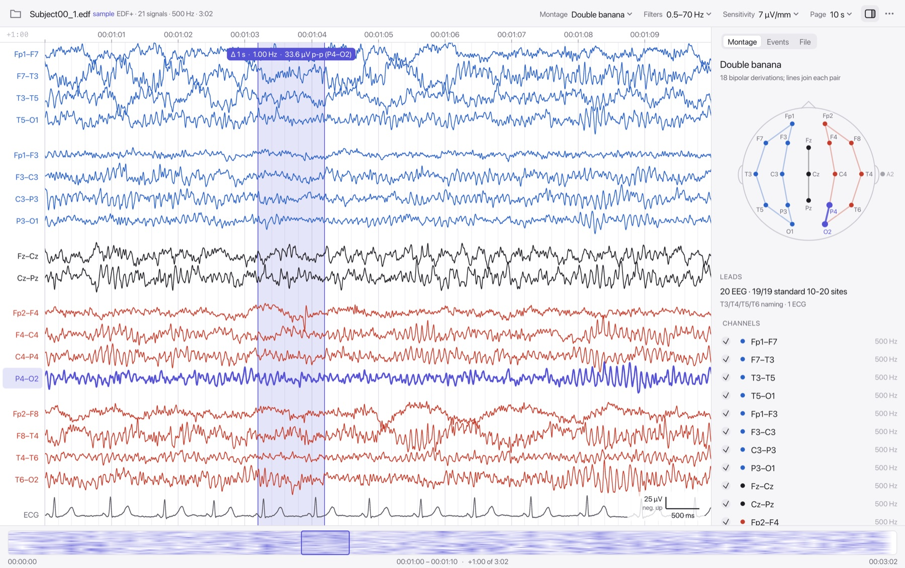
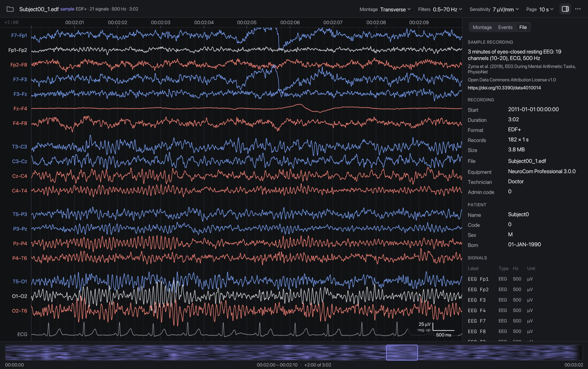
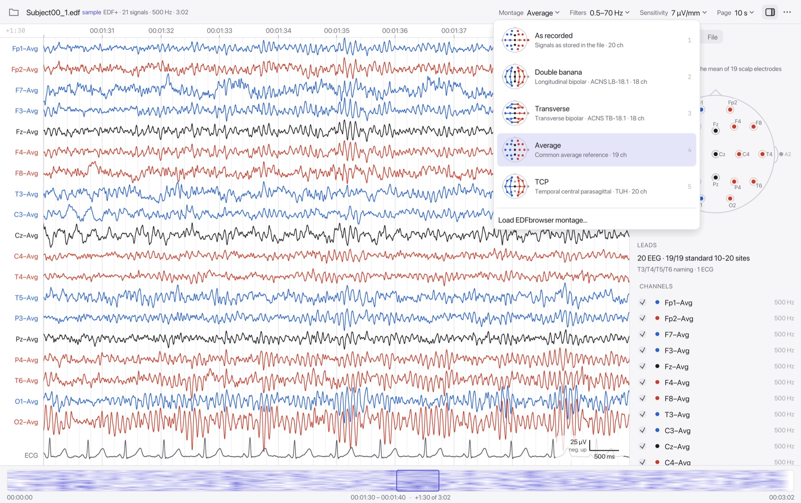

# Oink

A small, fast viewer for EEG recordings in EDF, EDF+, BDF and BDF+. Native on macOS and Windows: Rust, with traces drawn on the GPU through wgpu (Metal on macOS, DirectX 12 on Windows).

**[Download for macOS or Windows](../../releases/latest)**, then click **Try the sample recording** to see it with real EEG straight away.



- **Opens instantly, whatever the file size.** Only the header is read up front. Samples are read on demand for the part on screen, so a 500 MB recording uses about as much memory as a 30 MB one.
- **Works out what every signal is.** It reads labels, type prefixes and units ("EEG FP1-REF", "C4-M1", "Fc5.", "EEG T3-LE", "EKG1", "SaO2"), places electrodes on the 10-10 map (T3 stays T3 but sits at T7), and identifies the reference. Signals are always matched by label, never by their position in the file.
- **Montages are built for you.** Pick double banana (ACNS LB-18.1), transverse (TB-18.1), average reference, TUH's TCP, or "as recorded". Montages work even from bipolar recordings, and EDFbrowser `.mtg` files load too.
- **Shows montages on the head.** The sidebar draws the active montage's derivations on a head diagram. Hover a trace to see its electrodes, or hover an electrode to see its traces. The montage picker previews each montage the same way.
- **Clinical conventions, done properly.**
  - Sensitivity is in real µV per millimetre of your screen.
  - Negative is up (the EDF+ convention); this is a setting.
  - Filters are zero-phase Butterworth, with the stated cutoff as the true −3 dB point.
  - A calibrated scale bar is always visible.
- **Comes with a sample recording,** so there is something to look at before you have your own file.
- **Small.** The macOS app is about 12 MB and the Windows `.exe` about 16 MB, both including the 3.8 MB built-in sample. It uses about 70–110 MB of memory and no CPU while idle.

| | |
|---|---|
|  |  |

## Getting started

The easiest way is to download a build from [Releases](../../releases/latest). The builds aren't signed with a paid developer certificate, so the first launch asks once:

- **macOS:** drag Oink from the disk image into Applications and open it. When macOS says it could not verify Oink, click Done, then System Settings → Privacy & Security → **Open Anyway**.
- **Windows:** SmartScreen → **More info → Run anyway**.

To build it yourself:

**macOS**

```bash
./scripts/bundle-macos.sh
```

This builds `dist/Oink.app` and `dist/Oink-<version>-macos.dmg`. Drag the app into Applications. It then opens `.edf`, `.bdf` and `.rec` files from Finder, by double-click, with "Open With", or by dropping a file on its Dock icon. The script builds a universal (Apple silicon + Intel) app when both Rust targets are installed, and lays out the disk image with [dmgbuild](https://github.com/dmgbuild/dmgbuild), which it runs through [uv](https://docs.astral.sh/uv/) or pipx (`brew install uv`). The app is ad-hoc signed, which is enough on your own Mac; other Macs need a Developer ID signature and notarisation.

**Windows**

On Windows, run `cargo build --release`; the result is `target\release\oink.exe`, a single file with no installer. To cross-compile from a Mac instead (needs `brew install mingw-w64`):

```bash
./scripts/build-windows.sh
```

## Releases

`.github/workflows/build.yml` builds and tests on macOS and Windows for every push and pull request. Each run's page offers its builds for download.

A push to `main` whose `Cargo.toml` version has not been released yet also publishes a GitHub Release. The workflow tags the commit `v<version>` and attaches the macOS `.dmg` and the Windows `.zip`. So to release:

1. Bump `version` in `Cargo.toml`, for example to `0.2.0`.
2. Commit and push to `main`.
3. A few minutes later, "Oink 0.2.0" appears under Releases.

Pushes that do not change the version only build and test.

**From source, any platform**

```bash
cargo run --release -- recording.edf
```

This needs Rust 1.88 or newer.

## Using it

| | |
|---|---|
| ← →, PgUp PgDn | Previous / next page |
| Shift ← → | Step one second |
| Scroll or swipe | Move through time. With more channels than fit, vertical scroll moves through channels. |
| Cmd/Ctrl + scroll, pinch, Cmd/Ctrl −/+ | Zoom time around the pointer |
| ↑ ↓ | Sensitivity |
| Alt/Option + scroll | Sensitivity. Over a channel label, only that channel's gain. |
| Drag in the traces | Measure duration, frequency and peak-to-peak |
| Click a channel label | Select it; it is highlighted on the head |
| Click or drag the overview strip | Jump anywhere |
| [ ] | Previous / next event |
| 1–5 | As recorded, double banana, transverse, average, TCP |
| Cmd/Ctrl+O, W, I, F | Open, close, sidebar, find an event |
| ? | All shortcuts |

The toolbar shows the four things that change how EEG looks: montage, filters, sensitivity and page length. Anything else is in the sidebar or the ⋯ menu (theme, polarity, hemisphere colours).

**Sidebar**

- **Montage:** the head diagram, a summary of what was identified (for example "19/19 standard 10-20 sites · referenced to REF · T3/T4/T5/T6 naming"), labels that could not be placed, and a channel list with show/hide.
- **Events:** EDF+ annotations and decoded trigger codes, searchable. Click one to jump to it.
- **File:** recording and patient fields (EDF+ subfields decoded), every signal's header, and a header check that explains problems in plain language, such as a truncated file or a digital range that does not fit the sample size.

**Overview strip.** The strip along the bottom is a spectral overview (density spectral array) of the whole recording. Each frequency is shown relative to its own median, so sleep stages, seizures and artefacts stand out. Event ticks run along its top edge. It is computed in the background, coarse to fine, so a long recording has a usable overview within a moment.

**Command line**

```
oink --sample                   # open the built-in sample recording
oink --info recording.edf       # what the viewer makes of a file: header, leads, montages, warnings
oink recording.edf --montage banana --at 600 --page 20 --theme dark
oink recording.edf --montage my.mtg --screenshot page.png   # render a page to PNG and quit
```

## How leads are identified

Each signal's label is split into an optional type prefix, an active electrode and an optional reference. Then:

1. The electrode is looked up among 10-10 names, case-insensitively. Legacy names map to modern positions but keep their spelling (T3 → T7 position). A1/A2, M1/M2, T1/T2, Sp1/Sp2, PG1/PG2 and LOC/ROC (E1/E2) are known too.
2. The type comes from the prefix (`EOG`, `ECG`, `Resp`, ...), from keywords (`EKG1`, `SaO2`, `Chin`, `Thor`, `Status`, ...), and from the electrode itself: LOC/ROC are EOG. The unit decides scaling: µV, mV and V are converted to µV for EEG.
3. The reference becomes a node: an electrode (`C4-M1`, `Fp1-F7`), a named reference (`REF`, linked ears, `(A1+A2)/2`, average), or unstated.
4. Cap numbering is detected: BioSemi `A1…B32` and EGI `E1…E256`. These are not mistaken for an earlobe or an eye electrode.
5. Amplifier aux inputs (Nihon Kohden `X1…`, `DC01…`, BioSemi `EXG1…`) are fitted to their own lane, since they carry whatever was plugged in.

It has been checked against label conventions from TUH EEG, CHB-MIT, Sleep-EDF, PhysioNet EEGMMIDB (`Fc5.`), NSRR SHHS/MESA, Siena, BioSemi, EGI and Nihon Kohden. The test suite holds examples of each.

**Montages as algebra.** Every channel on screen is a linear combination of file signals. Recorded leads form a graph whose nodes are electrodes and references: `Fp1-REF` is an edge carrying V(Fp1) − V(REF). The difference between any two electrodes in the same connected part of the graph is the sum of the edges along a path between them. That one rule derives:

- bipolar montages from referential recordings
- a transverse montage from a longitudinal bipolar recording
- the average reference from either

It also refuses what cannot be derived. In CHB-MIT, the Fz–Cz–Pz chain is not connected to the other electrodes, so the viewer will not invent C3–Cz. A test checks that every montage gives identical traces whether the signals are stored in natural or scrambled order.

## Display conventions

- **Sensitivity** is µV per physical millimetre. The display's real size comes from CoreGraphics on macOS and the monitor's EDID-reported DPI on Windows, with 96 dpi as a fallback. The default is 7 µV/mm (ACNS).
- **Polarity** is negative-up by default. That is the clinical convention, and the EDF+ specification requires it. MNE and EEGLAB draw positive-up, so the scale bar always says which way is up, and the ⋯ menu switches it.
- **Filters**
  - The defaults are LFF 0.5 Hz and HFF 70 Hz, with the notch off. ACNS asks for LFF ≤ 1 Hz and HFF ≥ 70 Hz, and a notch only when needed.
  - Filters are Butterworth, run forwards then backwards (zero phase), so spikes stay aligned across channels.
  - Cutoffs are corrected for the double pass, so 1 Hz really is −3 dB at 1 Hz.
  - Each page is filtered with extra data on both sides, so there are no transients at its edges.
  - Zero-phase filtering spreads a very large step (such as the end of an amplifier calibration) a little backwards in time as well as forwards.
- **DC offset** is removed per page for EEG-like signals when no high-pass is active. Slow signals such as SpO₂ or temperature keep their level and are fitted to their lane from robust statistics. Unused inputs show as flat lines rather than amplified noise.
- **Colours:** left hemisphere is blue, right is red, and midline uses the text colour. Non-EEG channels are grey. This can be turned off.

## Performance and memory

- **Reads:** the file is never loaded. Positioned reads fetch only the records for the window being drawn. When only a few of many signals are needed, only their byte ranges are read.
- **Compute:**
  - A background thread computes the visible window plus half a page on each side: decode, combine, filter, remove offset, decimate.
  - Scrolling within that margin costs nothing. A newer request cancels an older one, so the UI never waits.
  - Work is split into batches when needed, so memory stays bounded at any zoom or channel count.
- **Decimation:** when samples outnumber pixels, each pixel column keeps its first, minimum, maximum and last sample (M4). This draws exactly what every sample would. Columns sit on a grid fixed to absolute time, so traces do not shimmer while scrolling.
- **Drawing:** all traces are one instanced GPU draw call with anti-aliased segments. Scrolling, sensitivity and channel spacing change only shader uniforms. When nothing changes, nothing is redrawn.

Measured on an M1 Max with a 1400×880-point window on a Retina display (2800×1760 pixels):

| | Memory (physical footprint) |
|---|---|
| Empty window | 70 MB |
| 30-minute, 37-signal Nihon Kohden EDF+, double banana | 83 MB |
| 2-hour, 66-signal, 512 Hz EDF+ (480 MB), 64-channel average reference | 109 MB |

Opening the 480 MB file and drawing its first page takes about a second, including the full-recording overview. The display's frame buffers are a large part of the baseline.

## Compared with other viewers

This design started from a survey of existing viewers and their open issues.

| Viewer | Strengths | What this viewer does differently |
|---|---|---|
| [EDFbrowser](https://www.teuniz.net/edfbrowser/) | The reference free viewer: everything, including annotation editing, analysis and exports | It has no official macOS build, montages are assembled by hand, and its issue tracker has gain and timing bugs with mV units and non-1 s records. Here montages are automatic, the macOS app is native, and those cases are tested. Its `.mtg` montages load directly. |
| [MNE-Python](https://mne.tools) `raw.plot` / mne-qt-browser | Scriptable, part of an analysis stack | Needs a Python environment and has OpenGL problems on recent macOS. This is a standalone 9 MB app. |
| EEGLAB `eegplot`, Brainstorm | Integrated with analysis | Need MATLAB (or its runtime) and slow down on large files. |
| [SigViewer](https://github.com/cbrnr/sigviewer) | Light, many formats via BioSig | Holds the whole recording in RAM; this viewer reads only what is on screen. |
| [Lunascope](https://zzz-luna.org/lunascope/) | Sleep scoring with hypnograms | Sleep-specific. This viewer is general EEG with clinical montages. |
| Polyman | EDF+ checks, sleep scoring | Windows-only, closed source, no longer developed. |
| Persyst, Natus NeuroWorks | Clinical review with trends and detection | Commercial and Windows-centred. |
| Web viewers (Epicurrents, edfviewer, ...) | Nothing to install | JavaScript memory grows with file size (2–3× the file in Epicurrents' own figures). |

What was kept from them:

- the ACNS montages and defaults
- µV/mm sensitivity with a scale bar
- LFF/HFF/notch
- annotations and triggers
- cursor measurement
- a whole-recording trend
- an EDF+ header check

What was left out to keep it simple:

- per-channel filter editors
- dialogs for building montages
- analysis tools that belong in an analysis package

## Project layout

```
src/edf.rs        EDF/EDF+/BDF/BDF+ reader: header, positioned reads, TALs, EDF+D, triggers
src/leads.rs      lead identification and the 10-10 electrode map
src/montage.rs    montage graph, ACNS/TUH templates, average reference, EDFbrowser .mtg
src/dsp.rs        zero-phase filters and M4 decimation
src/pipeline.rs   window -> GPU-ready polylines (batched, cancellable)
src/overview.rs   background spectral overview
src/app/          egui UI: trace view, wgpu renderer, head map, sidebar, navigator
src/platform.rs   screen size, system fonts, Finder "open file" events
src/icon.rs       the app icon (a piglet in an EEG headset), drawn in code
tests/files.rs    end-to-end tests on generated EDF/BDF files
scripts/          macOS app and disk image, Windows cross-compile
samples/          the built-in sample recording and its source and license
examples/         dump.rs (print samples, for cross-checking), synth.rs (large synthetic files)
```

`cargo test` runs the unit tests and generated-file tests: shuffled channel order, EDF+D gaps, sub-second starts, 24-bit BDF and Status triggers, truncated files, mixed sampling rates and mV units. Decoded samples and annotations were also cross-checked against MNE on a real Nihon Kohden recording.

## Limitations

- **Annotations are read-only.** No adding, editing or exporting yet.
- **No EDF export, printing or video sync.**
- **Linux** should build with eframe's X11/Wayland features enabled, but is not configured or tested.
- **On Windows, the `.exe` uses a generic file icon in Explorer.** The app icon is set at runtime, so the window and taskbar are fine.
- **It is a research tool, not a medical device.**

## Credits

The built-in sample is `Subject00_1.edf` from [*EEG During Mental Arithmetic Tasks*](https://physionet.org/content/eegmat/1.0.0/) on PhysioNet. It is distributed unmodified under the [Open Data Commons Attribution License v1.0](https://opendatacommons.org/licenses/by/1-0/); see [samples/README.md](samples/README.md).

Zyma I, Tukaev S, Seleznov I, Kiyono K, Popov A, Chernykh M, Shpenkov O. Electroencephalograms during Mental Arithmetic Task Performance. *Data*. 2019; 4(1):14. https://doi.org/10.3390/data4010014

Built with [egui](https://github.com/emilk/egui), [wgpu](https://wgpu.rs), [winit](https://github.com/rust-windowing/winit), [rfd](https://github.com/PolyMeilie/rfd), [rayon](https://github.com/rayon-rs/rayon) and [RustFFT](https://github.com/ejmahler/RustFFT).
